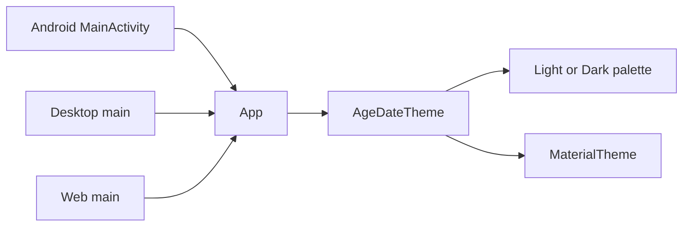

# Requirements

### Overview & Goals
Replace the default Material color scheme in the AgeDate app with a personal theme. The theme must follow the system light/dark mode and define custom colors for the app background and for the different text elements.

### Scope
**In Scope**
- A shared personal color scheme for light and dark mode.
- Applying it to the root `App()` composable so Android, desktop and web all get the same look.
- Using the theme colors for the background and all text colors on the main screen.

**Out of Scope**
- A manual in-app theme switcher.
- Persisting a user preference.
- Changing the date-calculation logic.

### User Stories
- As a user, I want the app background to use my personal color so that the app feels customized.
- As a user, I want the text colors to match my personal palette so that the content is readable.
- As a user, I want the app to switch between light and dark palettes automatically when the system mode changes.

### Functional Requirements
- The app uses a light palette when the system is in light mode and a dark palette when the system is in dark mode.
- The root background of `App()` uses the theme's background color.
- Titles, labels, input text, supporting text and the switch label use theme text colors.
- Text colors meet readable contrast against the background in both modes.

### Non-Functional Requirements
- The theme lives in shared code so no platform-specific code is needed.
- Colors are defined in one place so they can be edited easily.

# Technical Design

### Current Implementation
- `shared/src/commonMain/kotlin/org/example/project/App.kt` defines `App()` and selects a color scheme with `isSystemInDarkTheme()`, wrapping content in `MaterialTheme(colorScheme = ...)`.
- The current selection is inverted: `darkColorScheme()` is used when the system is in light mode and `lightColorScheme()` when it is dark.
- The scheme is the stock Material default, and text colors are hardcoded to `colorScheme.onPrimary`, which is not a text color on a background.
- Entry points that call `App()`: `androidApp/.../MainActivity.kt`, `desktopApp/.../main.kt`, `webApp/.../main.kt`.
- No existing theme file is present in the project.

### Key Decisions
- Create a shared `AgeDateTheme` composable in a new file so the palette is centralized and reused by all platforms.
- Keep `isSystemInDarkTheme()` as the mode source, so no platform code is required.
- Expose custom colors through a `ColorScheme` built with `lightColorScheme(...)` and `darkColorScheme(...)` with explicit `background`, `onBackground`, `surface`, `onSurface`, `primary` and `onPrimary` values.

### Proposed Changes
- Add a theme file that defines the light and dark personal palettes and a `AgeDateTheme(content)` composable that picks the scheme from the system mode and wraps `MaterialTheme`.
- In `App.kt`, remove the inverted `colorScheme` selection, wrap the content in `AgeDateTheme`, set the root `Box` background to `MaterialTheme.colorScheme.background`, and replace the hardcoded `colorScheme.onPrimary` text colors with `MaterialTheme.colorScheme.onBackground`.

### Data Models / Contracts
```kotlin
val PersonalLightColors = lightColorScheme(
    background = Color(0xFFF7F4EF),
    onBackground = Color(0xFF1F1B16),
    surface = Color(0xFFFFFFFF),
    onSurface = Color(0xFF1F1B16),
    primary = Color(0xFF3A6EA5),
    onPrimary = Color(0xFFFFFFFF)
)

val PersonalDarkColors = darkColorScheme(
    background = Color(0xFF1A1C1E),
    onBackground = Color(0xFFE6E1DA),
    surface = Color(0xFF24272B),
    onSurface = Color(0xFFE6E1DA),
    primary = Color(0xFF9CC3EA),
    onPrimary = Color(0xFF0B2236)
)

@Composable
fun AgeDateTheme(content: @Composable () -> Unit) {
    val colors = if (isSystemInDarkTheme()) PersonalDarkColors else PersonalLightColors
    MaterialTheme(colorScheme = colors, content = content)
}
```
The hex values are placeholders for the user's personal palette and are the only values to change later.

### File Structure
- Added: `shared/src/commonMain/kotlin/org/example/project/theme/AgeDateTheme.kt` (palettes and `AgeDateTheme`).
- Modified: `shared/src/commonMain/kotlin/org/example/project/App.kt`.

### Architecture Diagram


### Risks
- Text colors chosen from the palette may have low contrast; verify both modes.
- `OutlinedTextFieldDefaults` overrides for disabled states currently reference `MaterialTheme.colorScheme` and will follow the new palette automatically.

# Testing

### Validation Approach
- Build the shared module and the three app targets (Android, desktop, web) to confirm compilation.
- Inspect the rendered `App()` preview in both light and dark system modes to confirm background and text colors come from the personal palette.

### Key Scenarios
- System light mode: background uses `PersonalLightColors.background` and title, labels and switch text use `onBackground`.
- System dark mode: background uses `PersonalDarkColors.background` and text uses the dark `onBackground`.
- Date pickers and text fields still work after the theme change.

### Edge Cases
- Disabled outlined text fields keep readable text in both modes.
- Switching system mode at runtime updates colors without restarting the app.

### Test Changes
- No existing tests reference the color scheme; none need updating. No new automated tests are required beyond compilation and preview checks.

# Delivery Steps

### ✓ Step 1: Create the shared personal theme
AgeDateTheme provides personal light and dark palettes that follow the system mode.

- Add `shared/src/commonMain/kotlin/org/example/project/theme/AgeDateTheme.kt`.
- Define `PersonalLightColors` and `PersonalDarkColors` with explicit background, text, surface and primary colors.
- Implement `AgeDateTheme(content)` that picks the palette with `isSystemInDarkTheme()` and wraps `MaterialTheme`.

### * Step 2: Apply the theme to App and its text colors
App renders with the personal background and text colors in both system modes.

- In `App.kt`, remove the inverted `darkColorScheme()`/`lightColorScheme()` selection.
- Wrap the content in `AgeDateTheme`.
- Set the root `Box` background to `MaterialTheme.colorScheme.background`.
- Replace hardcoded `colorScheme.onPrimary` text colors with `MaterialTheme.colorScheme.onBackground`.
- Verify compilation for the shared module and the Android, desktop and web targets, and check the preview in light and dark modes.